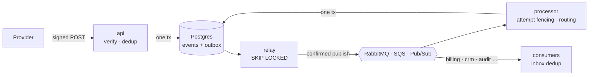

# hookgate-nest

[](https://github.com/Ahmedkholaif/hookgate-nest/actions/workflows/ci.yml)

**Webhook ingestion and fan-out in NestJS.** hookgate-nest verifies and dedupes incoming webhooks, queues them on **RabbitMQ, Amazon SQS or Google Pub/Sub**, processes them with retries and dead-lettering, and pushes the resulting messages over the same queues. Every message has its own status and timeline.

It is the NestJS twin of **[hookgate](https://github.com/Ahmedkholaif/hookgate)** (Go). Both services share the same HTTP API, the same Postgres schema (a byte-identical migration), the same wire envelope and the same deterministic message ids. CI runs them **on one database and one broker with the pipeline split between them**: Go relays and NestJS processes, then the other way round. It asserts that every message is delivered exactly once, and that a webhook ingested by one service is rejected as a duplicate by the other.



How duplicates are stopped at each hop (ingest dedup key, transactional outbox, leased relays, attempt fencing, UUIDv5 message ids, inbox) is covered in [hookgate's README](https://github.com/Ahmedkholaif/hookgate#how-duplicates-are-stopped). This implementation follows it statement for statement.

## Quick start

```bash
make up            # Postgres + RabbitMQ + 1 api + 2 workers (BROKER=sqs | pubsub to switch)
make demo          # 50 signed webhooks, 10 provider retries, 1 event that always fails
make up-mixed      # also start 2 Go workers on the same queues: both implementations share the load
```

With the mixed fleet, the status log shows the work split across both implementations:

```text
     actor      |      status       | count
----------------+-------------------+-------
 go/processor   | processed         |    26
 go/relay       | queued            |    26
 go/sink        | delivered         |    66
 nest/api       | duplicate_dropped |    10
 nest/api       | received          |    51
 nest/processor | processed         |    24
 nest/relay     | queued            |    27
 nest/sink      | delivered         |    64
```

Port 3000 is taken? Run `make up API_PORT=13000` and `make demo API_PORT=13000`. Kubernetes manifests and minikube/kind commands live in [hookgate](https://github.com/Ahmedkholaif/hookgate#kubernetes). Both images take the same environment variables.

## NestJS design

- **One image, any roles.** `ROLES=api,relay,processor,sink` (default: all). `AppModule.forRoot(config, broker)` is a dynamic module. It mounts the controllers only for the `api` role and registers the workers only when a broker is configured. A `WorkerRunner` starts them in `onApplicationBootstrap` and drains them in `beforeApplicationShutdown`.
- **The broker as a provider.** A `Broker` interface sits behind a `BROKER` injection token, with RabbitMQ (`amqplib`, quorum queues, confirm channels), SQS (`@aws-sdk/client-sqs`, batch send, long polling), Pub/Sub (`@google-cloud/pubsub`, flow control) and an in-memory implementation.
- **The exact signed bytes.** The app starts with `bodyParser: false`, so `/v1/ingest` gets a raw parser for any content type and the HMAC is checked over the bytes the provider signed. The rest of the API gets a 64 KB JSON parser.
- **Validation and errors.** `class-validator` DTOs with `forbidNonWhitelisted`, and a global exception filter that renders the Go service's `{"error": "…"}` shape and status codes.
- **SQL over an ORM.** `pg` with explicit transactions, so the statements can mirror the Go store one for one (`FOR UPDATE SKIP LOCKED`, `ON CONFLICT`, `xmax = 0` for insert-or-duplicate).

## Tests

```bash
make test    # needs Postgres; TEST_DATABASE_URL in the Makefile
```

- **End to end.** Three worker app instances on a broker that delivers every message **twice**. Each of the 140 outbound messages is created once and applied once, and the timeline reads `received → queued → processed`.
- **Retry with backoff, dead-letter, replay**, plus validation parity with the Go service and a message-id vector shared with Go.
- **Broker conformance suite** on real RabbitMQ, ElasticMQ (SQS) and the Pub/Sub emulator in CI, plus a pipeline smoke test on each broker.
- **Interop** with the Go service ([`scripts/interop.sh`](scripts/interop.sh)), in both directions.

## API and configuration

Identical to [hookgate](https://github.com/Ahmedkholaif/hookgate#api). The only difference is the HTTP port: `PORT` (default `3000`) instead of `ADDR`.

For deployment, tuning (`DB_MAX_CONNS`, concurrency), retention (`RETENTION_DAYS`), monitoring and the runbook, see the shared **[operations guide](https://github.com/Ahmedkholaif/hookgate/blob/main/docs/operations.md)**.

MIT licensed.
